<p align="center"></p>

# The kidney cancer methylome: a DNA methylation analysis in the LSMA Analysis Lab

**How does the DNA methylation landscape change when kidney tissue becomes clear cell renal cell carcinoma, and do those changes explain which genes switch on and off?**

This repository is a worked example from the **LSMA Analysis Lab**, the analysis platform of the [London School of Multiomics & AI](https://lsma.co.uk). The full analysis was run in the lab, without writing code: import of public data, quality control, exploration, differential methylation of single CpGs and of regions, and gene-set analysis. The report, figures and tables it produced are here, with two validation checks.

| | |
|---|---|
| **Data** | TCGA-KIRC (The Cancer Genome Atlas, kidney renal clear cell carcinoma), Illumina 450K methylation array, open access |
| **Samples** | 50: tumour and adjacent normal kidney from the same 25 patients |
| **Comparison** | tumour vs normal, paired by patient |
| **Lab module** | DNA methylation arrays (workflow version 1.0.0) |
| **Lab run time** | **10 min 17 s** for the whole analysis (plus 6 min 26 s to import 50 arrays from the GDC) |
| **Validation** | Independent cohort GSE61441 (46 patient pairs), same lab workflow: **9 min 17 s**. Link to gene expression from the [bulk RNA-seq analysis](https://github.com/MultiOmics-Intelligence/lsma-lab-bulk-rnaseq-kidney-cancer-tcga-kirc) |
| **Result** | **Replicated**: 98.6% of changed CpGs move the same way in the second cohort; promoter methylation and expression move in opposite directions |

---

## Biological question and aim

**Question.** Cancer cells rewrite the chemical marks on their DNA as well as their genes' activity. Which parts of the genome gain or lose methylation in clear cell kidney cancer, and do those changes line up with the genes that turn on and off in the tumour?

**Hypothesis.** Like most cancers, ccRCC should show two opposite changes:
- **focal gains of methylation in CpG islands**, often at developmental genes, silencing genes the tumour no longer needs
- **widespread losses of methylation** across the rest of the genome

Where a gene's promoter gains methylation its expression should fall, and where it loses methylation expression should rise.

**Aims**
1. Compare each patient's tumour with their own normal kidney (25 pairs) at 351,036 CpG sites, and find the CpGs and regions that change.
2. Describe where the changes fall (CpG islands, shores, open sea) and which gene sets they touch.
3. Check the changes in an independent group of patients (GSE61441).
4. Check that promoter methylation changes agree with gene expression changes measured in the same cancer.
5. Show each step as it is run in the LSMA Analysis Lab, so a student can repeat it.

---

## Background: DNA methylation in kidney cancer

**DNA methylation** is a small chemical tag (a methyl group) added to cytosines, mostly where a C is followed by a G, a "CpG". It doesn't change the DNA sequence, but it changes how genes are used:
- **Methylated promoters:** a gene's promoter (its on switch) that is heavily methylated is usually kept off.
- **Unmethylated promoters:** these are open for use.
- **CpG islands:** CpGs cluster near many promoters in stretches called **CpG islands**. Between genes they are sparse (the "open sea").

**The Illumina 450K array** measures methylation at about 450,000 CpGs. Each measurement is a **beta value**: the share of DNA copies that are methylated at that site, from 0 (none) to 1 (all).

**Cancers rewrite this pattern.** Tumours typically gain methylation at selected CpG islands, which can silence tumour suppressor and differentiation genes, and lose it across large parts of the genome. In **clear cell renal cell carcinoma**:
- The *VHL* gene is silenced by promoter methylation in a minority of tumours (it is more often mutated or deleted).
- Many genes are affected by methylation changes.
- Methylation patterns are being studied as markers of how aggressive a tumour is.

---

## Key findings

1. **Tumour methylation is changed and varied.**
   - Tumours and normals separate on the first principal component, which explains 59% of the variation (Figure QC5).
   - The normal kidneys cluster tightly, while the tumours are spread widely: each tumour has rewritten its methylation differently.
2. **68,925 CpGs change** by at least 0.1 in beta value (adjusted p < 0.05): **32,982 gain** methylation in tumour and **35,943 lose** it (Figure 1). The lab also found **10,444 differentially methylated regions** (5,902 gaining, 4,542 losing), 4,722 of them overlapping a promoter.
3. **The classic cancer pattern (Figure 2).**
   - **Gains sit in CpG islands:** 47% of the CpGs that gain methylation, against 39% of the CpGs that don't change.
   - **Losses sit in the open sea:** 61% of the CpGs that lose methylation lie between genes, against 28% of the CpGs that don't change.
   - Focal island hypermethylation plus widespread hypomethylation is the textbook signature of a cancer methylome.
4. **Developmental genes gain methylation.**
   - The strongest gained regions cover developmental regulators: the **HOXA5/HOXA6** cluster (49 CpGs, +0.24), **NKX6-2** (56 CpGs), **SPAG6**, **TRIM58**, **ASCL2** and **DIO3** (Figure 7).
   - The top gene set gaining methylation is a developmental transcription-factor set ("pancreas beta cells", Figure 8).
5. **Immune genes lose methylation.** The gene sets most affected by losses are inflammatory response, allograft rejection, complement and interferon-gamma response (Figure 8). This mirrors the strong immune signal found in the [bulk](https://github.com/MultiOmics-Intelligence/lsma-lab-bulk-rnaseq-kidney-cancer-tcga-kirc) and [single-cell](https://github.com/MultiOmics-Intelligence/lsma-lab-single-cell-kidney-cancer-ccrcc) analyses: immune cells inside the tumour bring their own, less methylated, immune genes.

Evidence labels from the lab: PCA and clustering are *exploratory*; the CpG and region lists are *statistically supported*; gene-set readings are *biological interpretation*.

---

## Quality control and PCA

### Quality control
Methylation arrays have their own failure modes: probes that do not measure reliably, probes on the sex chromosomes, probes disturbed by common DNA variants, and samples that hybridised poorly.

**Probe filtering** (Figure QC4):

| Kept or removed | Probes |
|---|---|
| **Kept** | **351,036** |
| Missing values (masked by the GDC's SeSAMe pipeline) | 59,701 |
| Sex chromosomes | 7,511 |
| Not CpG probes | 1,440 |
| Common SNP at the CpG | 1,349 |

**Sample checks** (Figures QC1–QC3):
- Each sample's beta-value distribution shows the expected two peaks, unmethylated near 0 and methylated near 1.
- 18 samples were flagged. In 15 of them SeSAMe had masked more than 5% of probes; those probes are removed for every sample anyway. Four (one also counted above) correlate less well with the others.
- All were kept, because the paired design compares each tumour only with its own normal tissue.

| | |
|---|---|
| 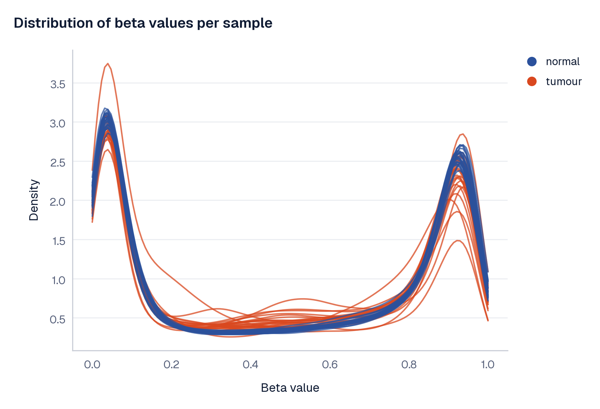 **QC2.** Beta-value distribution per sample. | 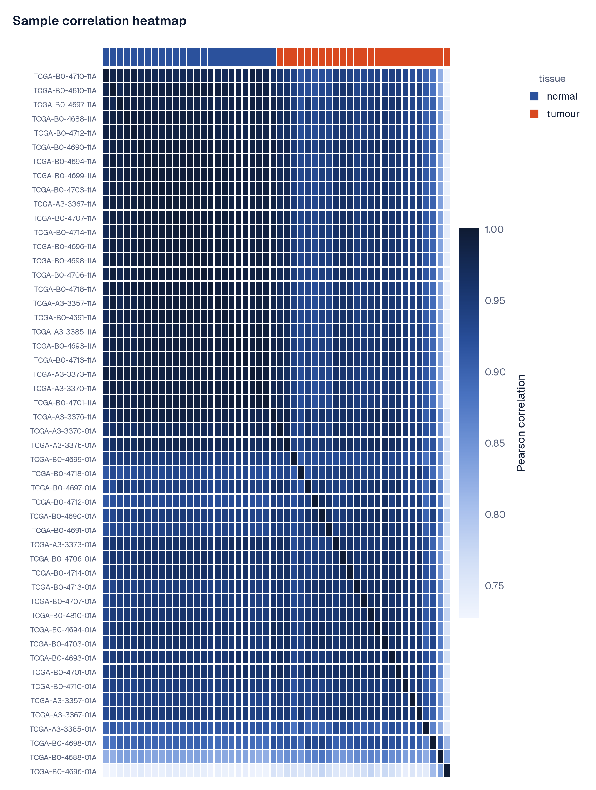 **QC3.** Sample correlation heatmap. |

### PCA
The 5,000 most variable CpGs, on the M-value scale:
- PC1 (59% of the variation) separates tumour from normal (Figure QC5).
- The lab's check of which sample-sheet column explains which component (Figure QC7) confirms that tissue drives PC1.

| | |
|---|---|
| 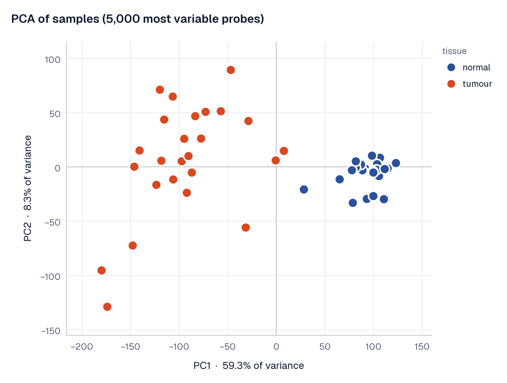 **QC5.** PCA of the 50 samples. | 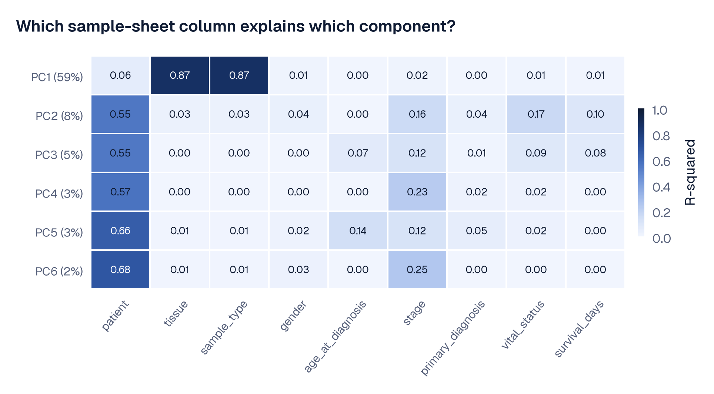 **QC7.** Which column explains which component. |

The median beta per sample (QC1), the probe filtering summary (QC4) and the scree plot (QC6) are in [`figures/`](figures).

---

## Figures

| | |
|---|---|
| 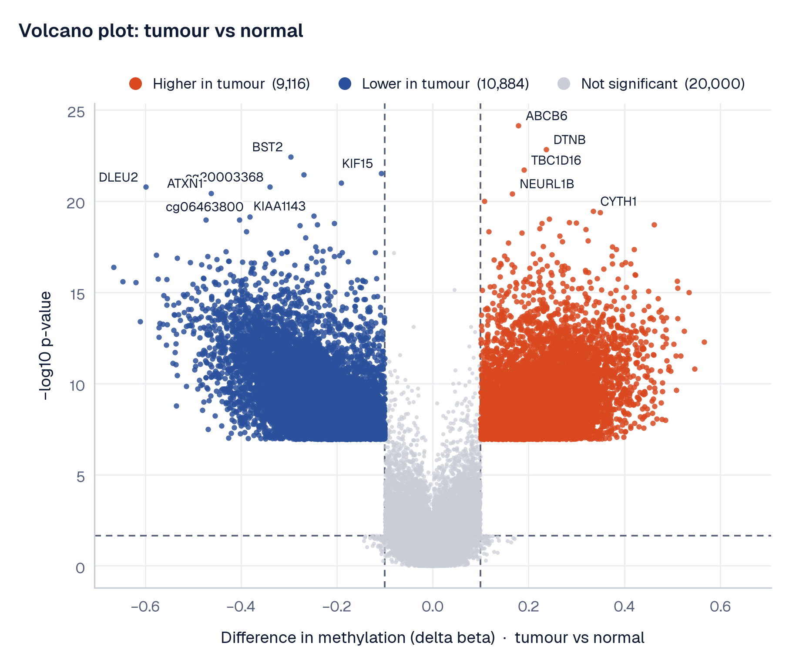 **Figure 1.** Volcano plot: each dot is a CpG, its methylation change (delta beta) against significance. | 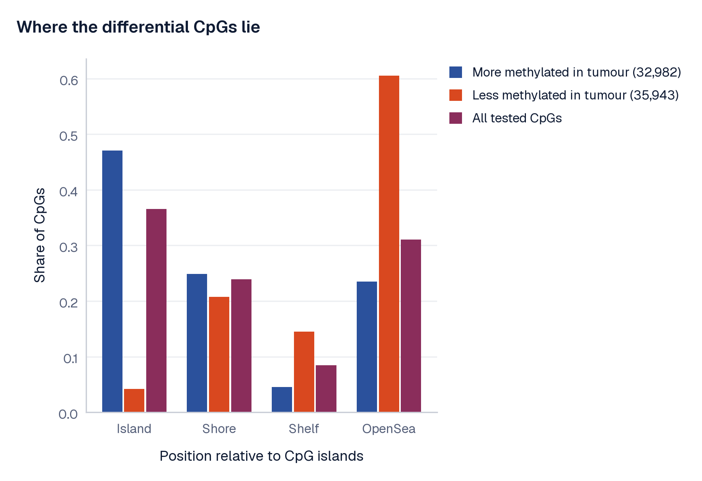 **Figure 2.** Where the changed CpGs lie: islands, shores, shelves, open sea. |
| 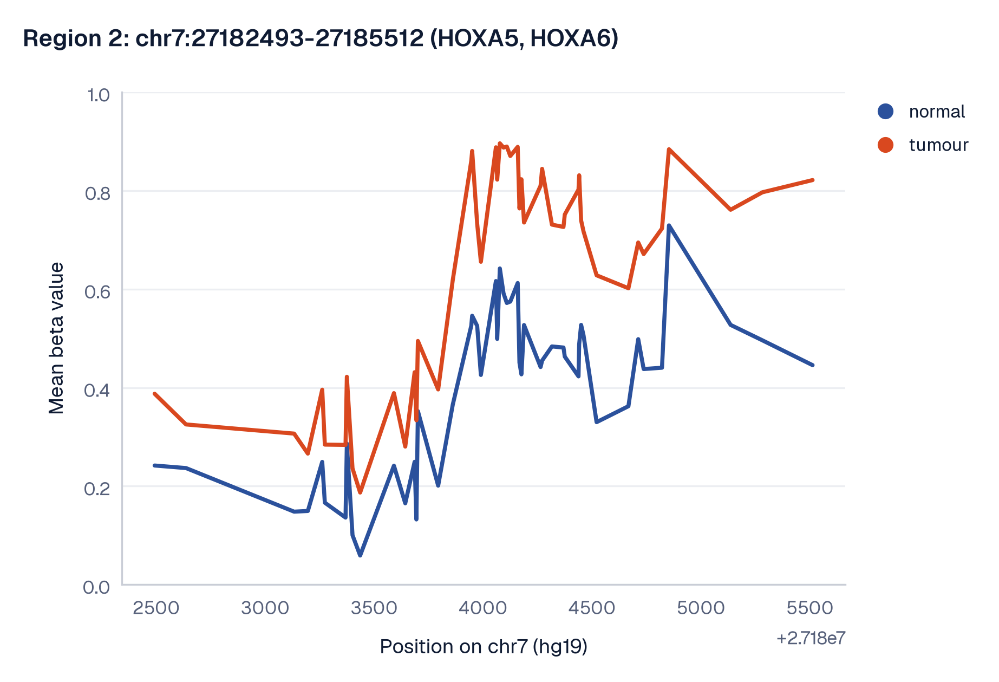 **Figure 7.** The HOXA5/HOXA6 region, which gains methylation in tumour. | 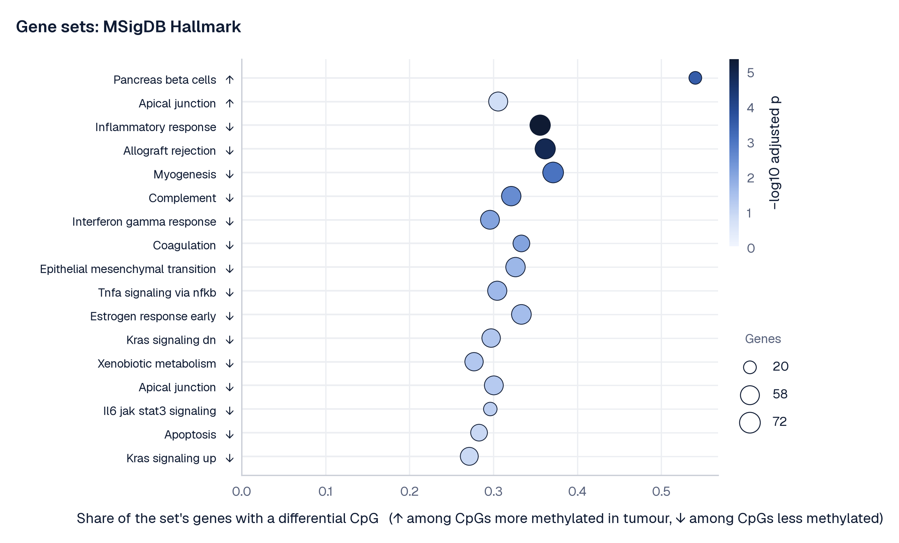 **Figure 8.** Hallmark gene sets touched by gains (↑) and losses (↓). |

All figures are in [`figures/`](figures), as PNG (300 dpi) and vector PDF:

| File | What it shows |
|---|---|
| 01 | Volcano plot |
| 02 | CpG context |
| 03 | Top CpGs |
| 04 | Heatmap of the top CpGs |
| 05 | Regions by direction |
| 06 | Region size and effect |
| 07 | HOXA region profile |
| 08, 09 | Gene sets, Hallmark and GO |
| qc-pca-* | Quality control and PCA |

## The full report

The lab's own report covers every stage: what was done, why, the checks, the results and their limits. It's available as a [**PDF**](report/LSMA-Analysis-Lab-report-kidney-cancer-DNA-methylation.pdf) or as [**HTML**](report/LSMA-Analysis-Lab-report-kidney-cancer-DNA-methylation.html) (download it and open it in a browser for the interactive version).

## Summary tables ([`results/`](results))

| File | Contents |
|---|---|
| `top100_cpgs_gaining_methylation.tsv` | The 100 most significant CpGs more methylated in tumour (padj < 0.05, delta beta ≥ 0.1) |
| `top100_cpgs_losing_methylation.tsv` | The 100 most significant CpGs less methylated in tumour |
| `top200_differentially_methylated_regions.tsv` | The 200 strongest regions: position, CpGs, mean and maximum delta beta, genes, promoter and island overlap |
| `gene_sets_hallmark.tsv` | Hallmark gene-set results for gains and losses |

CpG columns: probe, chromosome, position, gene and gene region, CpG context, promoter, mean beta in tumour and normal, delta beta, M-value difference, moderated t, p-value and adjusted p-value.

---

## Workflow

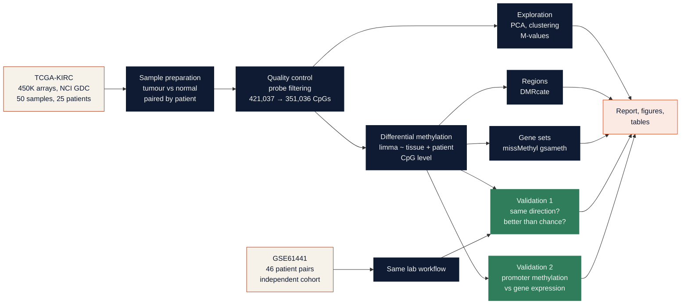

## How it was done

Every step below is a stage in the LSMA Analysis Lab, run with the settings in [`settings/analysis-settings.json`](settings/analysis-settings.json) (random seed 42).

1. **Data import.**
   - The study was found in the lab's public data search and imported from the NCI Genomic Data Commons: beta values from the GDC's SeSAMe pipeline.
   - 25 primary tumours and the matched normal kidney of the same patients were taken.
2. **Sample preparation.** Tumour against normal as the reference. The lab detected the pairs and proposed a **paired design** (`~ tissue + patient`).
3. **Quality control.** Probes with missing values, non-CpG probes, sex-chromosome probes and probes with a common SNP at the CpG were removed, leaving 351,036 CpGs. Each sample was checked for missing probes and correlation with the others.
4. **Exploration.** PCA, sample distances and hierarchical clustering on the 5,000 most variable CpGs (M-values).
5. **Differential methylation.**
   - Method: limma, one linear model per CpG on M-values, with a moderated t-test and Benjamini–Hochberg correction.
   - Effect sizes: delta beta from the same model on beta values.
   - A CpG is called at padj < 0.05 **and** |delta beta| ≥ 0.1.
6. **Regions.**
   - Method: DMRcate, which smooths the CpG statistics along the genome (1 kb bandwidth, FDR 0.05).
   - Thresholds: at least 3 CpGs and a mean |delta beta| ≥ 0.05.
7. **Gene sets.**
   - Method: missMethyl `gsameth`, which corrects for genes having different numbers of CpGs on the array.
   - Collections: Hallmark and GO Biological Process, tested separately for gains and losses.

**Software:** R 4.5.2 and Bioconductor 3.21, with limma, DMRcate, missMethyl and the Illumina 450K annotation (hg19), in the versions listed in the settings file.

---

## Validation

### 1. An independent cohort
**GSE61441** (Wei et al., *Nature Communications* 2015) holds clear cell kidney tumours and matched normal kidney from **46 different patients**, on the same 450K array, from a different group and country. Its published beta values were downloaded from GEO and uploaded into the lab as a beta-value table, then analysed exactly as above: tumour vs normal, paired by patient. Lab run time: **9 min 17 s**.

The CpGs called in TCGA were then looked up in this second cohort:

| CpG list from TCGA | Measured in GSE61441 | Same direction | Same direction **and** significant | Better than chance? |
|---|---|---|---|---|
| Top 100 gaining methylation | 55 | **55 (100%)** | 55 (100%) | p = 3 × 10⁻¹⁷ |
| Top 100 losing methylation | 27 | **27 (100%)** | 27 (100%) | p = 8 × 10⁻⁹ |
| All 68,925 called CpGs | 31,174 | **30,733 (98.6%)** | 26,666 (85.5%) | p < 10⁻³⁰⁰ |

*The GSE61441 authors released a filtered set of 229,844 probes, so not every TCGA CpG is present there. "Better than chance" is a one-sided binomial test against the 50% expected if directions were random.*

The size of the change agrees too: delta beta correlates at ρ = 0.83 across the called CpGs, and at 0.77 across all 202,054 CpGs measured in both cohorts (Figure V1).

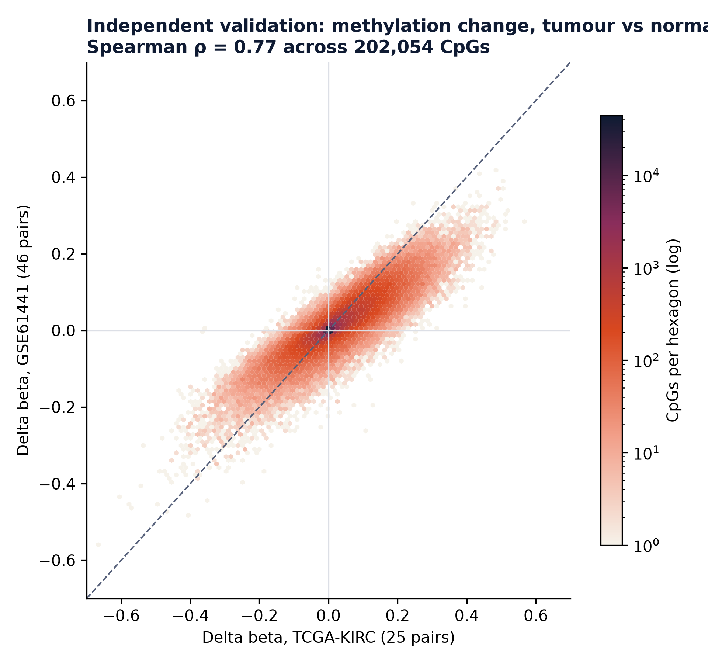

**Figure V1.** Methylation change in TCGA (x) against GSE61441 (y), for every CpG measured in both. The dashed line marks perfect agreement.

**Verdict: replicated.**

### 2. Does methylation explain expression?
The same TCGA kidney cancer cohort was analysed by RNA-seq in the [bulk RNA-seq repository](https://github.com/MultiOmics-Intelligence/lsma-lab-bulk-rnaseq-kidney-cancer-tcga-kirc). For each of 12,313 genes, the mean methylation change of its promoter CpGs (at least two) was set against its expression change (Figure V2):

| Genes | Count | Strongly lower in tumour (RNA) | Strongly higher in tumour (RNA) |
|---|---|---|---|
| All genes | 12,313 | 14% | 12% |
| Promoter **gains** methylation (≥ +0.2) | 39 | **54%** | 3% |
| Promoter **loses** methylation (≤ −0.2) | 88 | 6% | **69%** |

*"Strongly" means at least two-fold, adjusted p < 0.05.*

- **Gained methylation goes with silencing:** *RAB25*, *SALL3*, *IRX1*, *SPAG6* and *TMEM213* gain promoter methylation and fall sharply in expression.
- **Lost methylation goes with activation:** *NNMT*, immune genes such as *GZMB*, *ITK* and *CD48*, and **CA9**, the marker gene of this cancer. CA9's promoter loses methylation (−0.24) and its expression rises about 600-fold.
- **Overall:** promoter methylation and expression change in opposite directions (Spearman ρ = −0.26 across all genes).

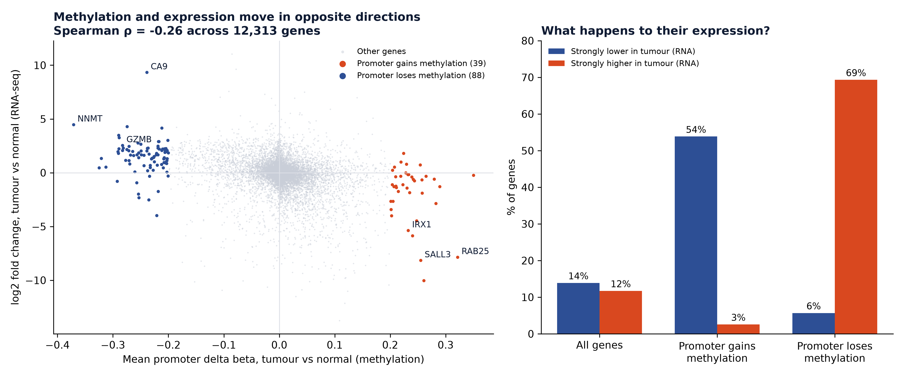

**Figure V2.** **Left:** promoter methylation change against expression change for each gene. **Right:** how often genes are strongly lower or higher in tumour, by promoter methylation group.

All validation files, including the lab's report for the second cohort, are in [`validation/`](validation).

---

## Limitations

- **Tumour tissue is a mixture.** Part of the methylation change reflects a different mix of cells: tumours hold many immune cells and fewer normal tubule cells. The loss of methylation at immune genes is largely this effect, consistent with the [single-cell analysis](https://github.com/MultiOmics-Intelligence/lsma-lab-single-cell-kidney-cancer-ccrcc). Cell-type deconvolution would separate the two.
- **Cross-reactive probes weren't removed.** Some 450K probes also bind elsewhere in the genome, and no list of them is installed in the lab yet. Single-CpG results should be read with that in mind; region and gene-set results are less affected.
- **Different processing in the two cohorts.** TCGA beta values come from SeSAMe, GSE61441 from the authors' own pipeline. Agreement despite that is reassuring, but small shifts in delta beta between the two are expected.
- **Methylation–expression is a correlation.** Opposite changes are consistent with promoter methylation silencing genes, but don't prove that one causes the other.
- **A teaching example, not clinical advice.** These results are for education and must not be used to diagnose or treat anyone.

---

## Repository structure

```
lsma-lab-dna-methylation-kidney-cancer-tcga-kirc/
├── README.md                  this case study
├── LICENSE                    CC BY 4.0
├── assets/
│   └── lsma-lab-kidney-methylation-banner.svg     animated banner
├── report/                    the LSMA Analysis Lab's full report of the main run
│   ├── LSMA-Analysis-Lab-report-kidney-cancer-DNA-methylation.pdf
│   └── LSMA-Analysis-Lab-report-kidney-cancer-DNA-methylation.html
├── figures/                   key figures, PNG (300 dpi) and vector PDF
│   ├── 01-volcano ... 09-gene_sets_go_bp       differential methylation, regions, gene sets
│   └── qc-pca-*                                 quality control and PCA
├── results/                   summary tables (tab-separated)
│   ├── top100_cpgs_gaining_methylation.tsv
│   ├── top100_cpgs_losing_methylation.tsv
│   ├── top200_differentially_methylated_regions.tsv
│   └── gene_sets_hallmark.tsv
├── validation/                independent cohort and the link to gene expression
│   ├── validation-delta-beta-agreement.png / .pdf
│   ├── validation-methylation-vs-expression.png / .pdf
│   ├── replication_summary.tsv
│   ├── promoter_methylation_vs_expression.tsv
│   └── LSMA-Analysis-Lab-report-validation-GSE61441.pdf
└── settings/
    └── analysis-settings.json           every parameter, software version and the random seed
```

## Data source and credits

- **Data:**
  - The Cancer Genome Atlas (TCGA-KIRC), open-access methylation beta values from the [NCI Genomic Data Commons](https://portal.gdc.cancer.gov/projects/TCGA-KIRC), under the [GDC data use policies](https://gdc.cancer.gov/access-data/data-access-processes-and-tools).
  - Validation cohort [GSE61441](https://www.ncbi.nlm.nih.gov/geo/query/acc.cgi?acc=GSE61441), from NCBI GEO.
  - No raw data are copied into this repository.
- **Validation study:** Wei JH, Haddad A, Wu KJ, et al. A CpG-methylation-based assay to predict survival in clear cell renal cell carcinoma. *Nature Communications* 2015;6:8699 (PMID 26515236).
- **Reference study:** Cancer Genome Atlas Research Network. Comprehensive molecular characterization of clear cell renal cell carcinoma. *Nature* 2013;499:43–49.
- **Methods:**
  - Ritchie et al., *Nucleic Acids Research* 2015 (limma)
  - Peters et al., *Epigenetics & Chromatin* 2015 (DMRcate)
  - Phipson, Maksimovic & Oshlack, *Bioinformatics* 2016 (missMethyl)
  - Du et al., *BMC Bioinformatics* 2010 (M-values)
- **Companion analyses:**
  - [bulk RNA-seq, tumour vs normal](https://github.com/MultiOmics-Intelligence/lsma-lab-bulk-rnaseq-kidney-cancer-tcga-kirc)
  - [single-cell RNA-seq](https://github.com/MultiOmics-Intelligence/lsma-lab-single-cell-kidney-cancer-ccrcc)

## Run it yourself

Diploma students of the London School of Multiomics & AI can repeat this analysis in the **LSMA Analysis Lab**:
1. **Public data** → TCGA → *TCGA-KIRC* → DNA methylation.
2. 25 tumour and 25 normal samples.
3. Confirm the paired preparation.
4. Run **DNA methylation arrays**.

Find out more about the diplomas at [lsma.co.uk](https://lsma.co.uk).

## Licence

The text, figures and tables in this repository are shared under [Creative Commons Attribution 4.0 (CC BY 4.0)](https://creativecommons.org/licenses/by/4.0/): you may reuse them with credit to the London School of Multiomics & AI. TCGA and GEO data remain under their own terms.

---

**Dr. Anas Alzaeem**, Academic Director, London School of Multiomics & AI


